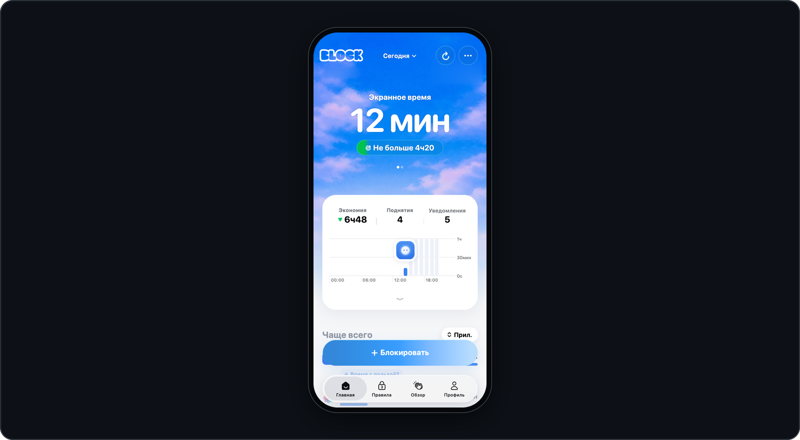

# screen-time-blocker

Мобильный прототип настройки экранного времени на Expo Go. Правила и настройки сохраняются на устройстве; реальная блокировка приложений и данные Экранного времени пока недоступны.

<a href="https://github.com/egorovdnikita/screen-time-blocker"></a>

## Возможности и ограничения

- Знакомство, локальный профиль, цели, сессии, лимиты и рутины; создание и удаление правил, шаблоны, дневник.
- Настройки хранятся в AsyncStorage. Сброс: «Настройки → Данные на устройстве».
- Локальные уведомления реализованы только для iOS; в этой проверке на устройстве не проверялись. Напоминания по фактическому экранному времени недоступны.
- Графики и статистика с образцовыми цифрами доступны в демо; в реальном режиме показаны пустые состояния. «Обзор» — заглушка.
- Демо-меню доступно только в режиме разработки: долгое нажатие на «⋯» на Главной или в Правилах. Демонстрационные данные отделены от пользовательских.
- Веб — превью мобильного интерфейса. Нативная блокировка, Android и системные разрешения не приняты.

## Запуск без компьютера

Приложение опубликовано через Expo Update в аккаунте `egorov_d_nikita`, канал `preview`. Mac, Metro и туннель для запуска не нужны. В Expo Go нужно войти в этот аккаунт; опубликованные проекты доступны владельцу и участникам его организации.

[Открыть в Expo Go](exp://u.expo.dev/b939e29d-7990-4b6e-869e-0b9af11259b9/branch/01a21aa6-a072-7496-b4c9-e1c755d21c84). Ссылка для открытия и результаты проверки — в [инструкции](docs/EXPO_GO.md).

## Локальная разработка

Нужны Node.js 22.13+ и Expo Go, совместимый с SDK 58.

```sh
npm ci
npx expo start --clear
```

Откройте QR-код в Expo Go. Для доступа через мобильную сеть: `npx expo start --tunnel --clear`. Веб-превью: `npm run web`.

## Проверки и сборка

```sh
npm run typecheck
npm run lint          # предупреждения тоже считаются ошибкой
npm run format:check  # Prettier; исправить — npm run format
npm test              # проверки без браузера
npx expo export --platform web
```

Те же четыре проверки запускает GitHub Actions на каждый PR и push в `main`.

Регрессионные сценарии находятся в `tools/check-*.mjs`; `npm test` запускает те, что не требуют браузера (список в `tools/run-checks.mjs`). Браузерным сценариям нужен Google Chrome и запущенная веб-версия. Адрес задаётся через `EXPO_WEB_URL` (по умолчанию `http://localhost:8082`).

## Стек

Expo, React Native, React, Expo Router, TypeScript

## Документация

- [Правила проекта](AGENTS.md)
- [Текущая задача и история решений](docs/HANDOFF.md)
- [Устройство проекта](docs/structure.md)
- [Покрытие 267 состояний](docs/SCREEN_COVERAGE.md)
- [Журнал аудитов](docs/AUDIT_LOG.md)
- [Нативная блокировка: решение 001](docs/decisions/001-native-screen-time.md)

## Лицензия

[MIT](LICENSE). Демонстрационные люди и данные вымышлены.
